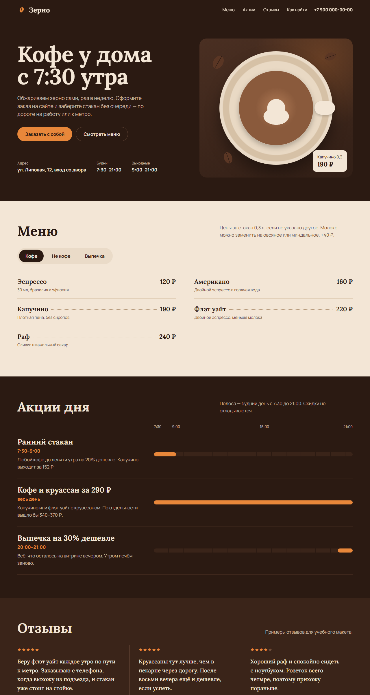

# Зерно — лендинг кофейни у дома

Учебный проект для портфолио на FL.ru. Кофейня «Зерно», адрес, телефон и отзывы вымышленные, реального клиента нет.

Живая версия: https://xevorin.github.io/zerno-coffee/



## Что есть на странице

- Первый экран с адресом и часами работы: открываемся в 7:30, в выходные в 9:00.
- Меню на 12 позиций с ценами, три вкладки: кофе, не кофе, выпечка. Вкладки переключаются стрелками с клавиатуры.
- «Акции дня» на шкале будничного дня: видно, в какие часы действует каждая скидка.
- Три отзыва.
- «Как найти»: Яндекс Карта (виджет без ключа API), адрес, часы работы.
- Контакты и подвал со ссылкой на профиль автора.
- Кнопка «Заказать с собой» открывает форму заказа: имя, телефон, время, когда заберёте, позиции из меню с количеством. Сумма считается сама. Телефон проверяется: нужен российский мобильный номер из 11 цифр. После отправки форма показывает «Заказ принят».

Форма демонстрационная: заказ никуда не отправляется, введённые данные нигде не сохраняются.

## Адаптив и доступность

- Вёрстка работает от 360 px, без горизонтальной прокрутки.
- Видимый фокус для клавиатуры, ссылка «Перейти к содержимому».
- Модальное окно на `<dialog>`: закрывается по Esc и клику по фону, фокус возвращается на кнопку.
- Учитывается настройка `prefers-reduced-motion`.
- Заголовки идут по порядку, без пропусков уровней.
- Есть meta description, Open Graph и favicon.

## Стек

HTML, CSS и JavaScript без фреймворков и сборщиков. Шрифты Lora и Manrope из Google Fonts. Иллюстрация чашки нарисована на CSS, фотографий нет.

Файлы:

- `index.html` — разметка;
- `style.css` — стили;
- `script.js` — вкладки меню и форма заказа.

## Как открыть локально

Скачайте папку и откройте `index.html` в браузере. Сервер не нужен.

Если нужен локальный сервер, например для проверки путей:

```
python -m http.server 8000
```

и откройте http://localhost:8000/.

## Автор

Егор Фарафонов, [профиль на FL.ru](https://www.fl.ru/users/farafonovegor07/).
